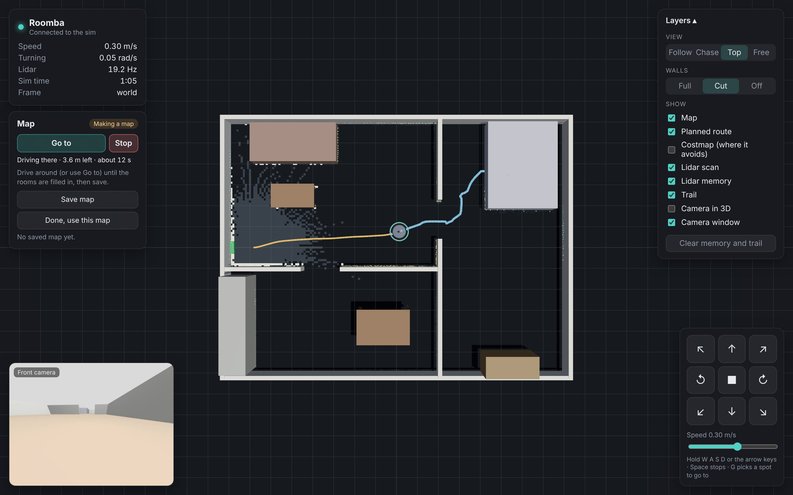

# Simulation

A simulated Roomba with the LD19 lidar and front camera, in a small apartment, running in
Gazebo Harmonic inside Docker, with our 3D web UI next to it. It publishes the **same topics as the real robot** (`/cmd_vel`,
`/odom`, `/tf`, `/scan`, `/camera/image_raw`, `/camera/camera_info`), and runs the same mapping
(slam_toolbox) and navigation (Nav2) as the robot, so everything can be built and tested here
first and then run unchanged on the Pi.

## One-time setup (Mac)

1. Install [Docker Desktop](https://www.docker.com/products/docker-desktop/) (or OrbStack).
   In Docker Desktop settings, give it at least **4 CPUs and 6 GB of memory**.
2. Clone the repo: `git clone https://github.com/akeklak/roomba-raspi.git && cd roomba-raspi`

## Run it

```bash
./scripts/sim.sh up        # first run builds the images, about 10 minutes
```

Wait for the log to settle (about 30 seconds), then open **http://localhost:8080**.
After you pull new changes, run `./scripts/sim.sh up` again so both images are rebuilt.


What you see:

- **The apartment in 3D**: walls, furniture and the dock, read from the same world file Gazebo
  uses. **Walls → Cut** lowers the walls so you can see into the rooms; **Full** and **Off** too.
- **The robot**: the Roomba 675 model from `description/`, with a teal ring around it so it's
  easy to find.
- **Map**: the map the robot is making (or the saved one it is using): free floor slightly
  lighter, walls bright, unexplored floor left clear. See [Maps and navigation](#maps-and-navigation).
- **Planned route** (blue) and the goal (teal ring) while the robot drives itself somewhere.
- **Costmap (where it avoids)**: Nav2's view of the obstacles, grown by the robot's size, in
  bright red: solid at walls and where the robot's middle can't go, fading out over about half a
  meter where it prefers not to go. It comes from Nav2, so it shows once navigation is running
  (a few seconds after startup). Off by default.
- **Lidar scan** (bright dots, warm when close, cool when far) and **Lidar memory** (teal dots
  that stay): every spot the lidar has hit, so the room "builds up" as you drive. Each scan is
  pinned where SLAM or localization says the robot was at that moment, and a spot only shows
  once two scans have hit it. The memory never moves afterwards, so if SLAM later corrects
  itself, the **Map** layer is the one to trust. **New map** clears the memory.
- **Trail**: where the robot has been.
- **Camera**: the front camera in the corner (click it to make it bigger). **Camera in 3D** also
  draws what the camera sees as a picture in front of the robot.
- **Views**: Follow (moves with the robot, drag to orbit, scroll to zoom), Chase (rides behind
  it), Top (whole apartment from above) and Free.

Drive with **W A S D** or the **arrow keys** (hold to move, let go to stop, Space stops), or hold
the on-screen arrows. The slider sets the top speed, both for driving by hand and for **Go to**.
Driving by hand while the robot is driving itself somewhere stops that, so you can always take
over.

Driving by hand slows down and stops a few centimeters short of anything the lidar sees in the
way, and stops when the robot turns out to be pushing against something too low for the lidar
(like the dock behind where it starts): the page says so. Turning is always allowed, and so is
driving the other way. This matters for the map: pushing against something makes the wheels
spin in place, so the wheel odometry says the robot is moving when it isn't, and SLAM can lose
track of where it is for good (walls drawn twice, map cells outside the walls). If that ever
happens, **New map** starts over.

**Top** shows the whole apartment:


**Clear memory and trail** starts the lidar memory and the trail fresh.

## Maps and navigation

The **Map** panel under the status shows what the robot is doing:

- **Making a map**: slam_toolbox builds the map from the lidar as the robot moves. This is what
  happens the first time, when there is no saved map yet.
- **Using the saved map**: the saved map is loaded and AMCL works out where the robot is on it by
  matching the lidar against it. This is what happens on every start once a map is saved.

To make a map and send the robot places:

1. Start the sim and open http://localhost:8080. The Map panel says **Making a map**, and the
   room around the robot fills in on the floor within a few seconds.
2. Fill in the rest of the apartment, either by driving (W A S D), or with **Go to** (or the
   **G** key): click a spot on the floor and the robot drives there by itself, going around
   furniture and mapping on the way. Press and drag instead of clicking to also choose which way
   it should face when it gets there. Unexplored floor counts as drivable, so you can click into
   a room it hasn't seen yet.
3. When the rooms are filled in, press **Done, use this map**. It saves the map and switches to
   navigating on it. (**Save map** saves without switching, if you want to keep mapping.)
4. From now on, **Go to** drives the robot around on the saved map. **Stop** (or Space) stops it.



Other buttons, once a map is saved:

- **Set position**: if the robot is lost on the map (its lidar dots don't line up with the map's
  walls), click where it really is and drag the way it faces. It firms up as the robot moves.
- **Add to map**: back to mapping, on top of the saved map, to add a room you missed or fix a
  moved piece of furniture. Then **Done, use this map** again.
- **New map**: start over from scratch. The saved map stays until you save the new one, and the
  save before that is always kept as `maps/home.previous.*`.

Maps are saved in `maps/` in your checkout (`home.pgm` is the picture, `home.yaml` its scale for
Nav2, `home.posegraph`/`home.data` slam_toolbox's copy for adding to it later), so they survive
`./scripts/sim.sh down`. Delete `maps/` to start fresh.

How it works: `map_manager` (in `ros2_ws/src/roomba_nav`) runs either slam_toolbox (mapping) or
map_server + AMCL (navigating on the saved map), switches between them when you press the buttons,
and starts Nav2 once the robot is on a map. Nav2 plans with NavFn on the map and drives with the
Regulated Pure Pursuit controller, at up to 0.3 m/s. The web bridge passes the buttons and goals
from the page to those nodes, and the map, planned route and progress back. The settings are in
`ros2_ws/src/roomba_nav/config/` (`slam.yaml` and `nav2.yaml`).

In the sim, SLAM or AMCL corrects for wheel slip just like on the robot. To compare, the sim can
also run without them: `localization:=ground_truth` places the robot from Gazebo's true position,
and `localization:=odom` shows the raw drift (in `docker/compose.yaml`, add it to the end of
`command`). Neither runs mapping or navigation.

You can also drive from the keyboard in a terminal:

```bash
./scripts/sim.sh teleop    # i = forward, , = back, j / l = turn, k = stop
```

Other commands:

```bash
./scripts/sim.sh shell     # shell inside the sim: ros2 topic list, ros2 topic hz /scan, ...
./scripts/sim.sh down      # stop
```

From the shell you can also drive the map buttons and goals by hand:

```bash
ros2 service call /map_manager/save_map std_srvs/srv/Trigger           # or use_saved_map, new_map, extend_map
ros2 topic echo --once /map_manager/state                              # what it's doing, as JSON
ros2 action send_goal /navigate_to_pose nav2_msgs/action/NavigateToPose \
  "{pose: {header: {frame_id: map}, pose: {position: {x: 2.0, y: 0.0}, orientation: {w: 1.0}}}}"
```

Code changes under `ros2_ws/src` and `web/` are picked up on the next
`./scripts/sim.sh up`. For quick UI work, leave the sim running and start the UI with hot reload
instead: `cd web && npm install && npm run dev` (needs Node 22), then open http://localhost:8080
(stop the `ui` container first, or use `npm run dev -- --port 5173`).

## What's in the world

`ros2_ws/src/roomba_sim/worlds/apartment.sdf`: about 8 m × 6 m with a living room, a bedroom
and a kitchen joined by 0.9 m doorways. A coffee table and dining table whose tops sit above
the lidar, so it only sees their legs (as the real one will). A couch, bed, counter and dresser.
The dock is the green block on the west wall; the robot starts just east of it, facing east.

## How it maps to the real robot

| | Real robot | Simulation |
| --- | --- | --- |
| Body | Roomba 675 | the Roomba 675 model in `description/` (meshes, 2.72 kg, 239 mm wheel track); the 3D view in the browser shows the same meshes |
| Drive | create_driver over serial | Gazebo DiffDrive plugin, same 0.5 m/s limit |
| Lidar | LD19, 455 beams, 10 Hz | gpu_lidar, 455 beams, 10 Hz, 1 cm noise |
| Camera | OV5647 fisheye | 320×240 wide-angle camera (~140°), rendered only while the web UI shows it |
| Frames | `map → odom → base_footprint → base_link → ldlidar_link`, `camera_link`, `camera_optical_link` | same, plus `world → map` fixed at where the robot starts, so the map lines up with the 3D apartment |
| Localization | slam_toolbox while mapping, AMCL on the saved map | same (or `localization:=ground_truth` / `odom`, without mapping) |
| Maps | `~/roomba_maps` on the Pi | `maps/` in your checkout |

Not simulated yet: bumpers, cliff sensors, battery, docking and the vacuum. Those come with
phase 3.

The sim keeps to real time (**Sim time** in the status panel keeps pace with a clock). Gazebo
renders the lidar and camera in software here, and pauses the physics while it does, which on its
own made the kitchen run at about 0.7x. Three things make up for it: the camera is small and only
rendered while the web UI shows it, physics steps are 2 ms, and `realtime_pacer` raises Gazebo's
target speed just enough to make up the time spent rendering (it logs when it does). If the
machine is too busy to keep up anyway, the clock and everything with it runs slow; it never
skips ahead.

## Linux server instead

The same `./scripts/sim.sh up` works on any Linux machine with Docker. On an Ubuntu 24.04 desktop
with ROS 2 Jazzy installed natively you can also see the Gazebo window:
`ros2 launch roomba_sim sim.launch.py headless:=false`.

## Automated check

CI runs two checks against the sim on every pull request:

- `ros2 run roomba_sim smoke_test`: the lidar returns 455 beams that hit walls, the camera
  publishes, the world shapes for the web UI are published on `/sim/world`, and the robot moves
  about 0.9 m when driven at 0.3 m/s for 3 seconds.
- `ros2 run roomba_nav nav_test`: does what you would do in the web UI, through the same web
  bridge. While mapping it sends the robot into the bedroom through a doorway and checks the map
  has walls in it; then it saves the map, switches to navigating on it and sends the robot to the
  kitchen; then it checks that both Stop and driving by hand stop a goal; then it adds to the
  saved map, drives to the living room and switches back. Each arrival is checked
  against Gazebo's true position (within 35 cm). It starts a new map and saves it, so in your own
  sim it replaces your saved map (the old one is kept as `maps/home.previous.*`).

The web UI's own tests and build run there too.
