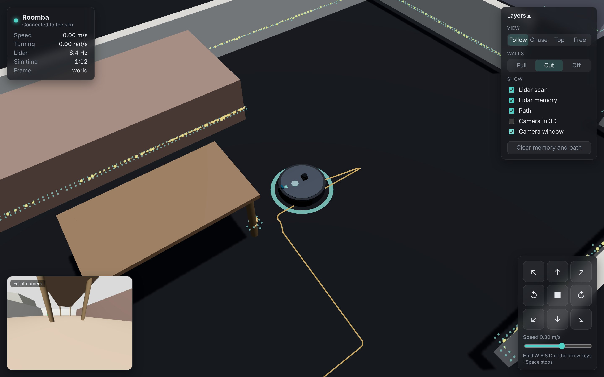
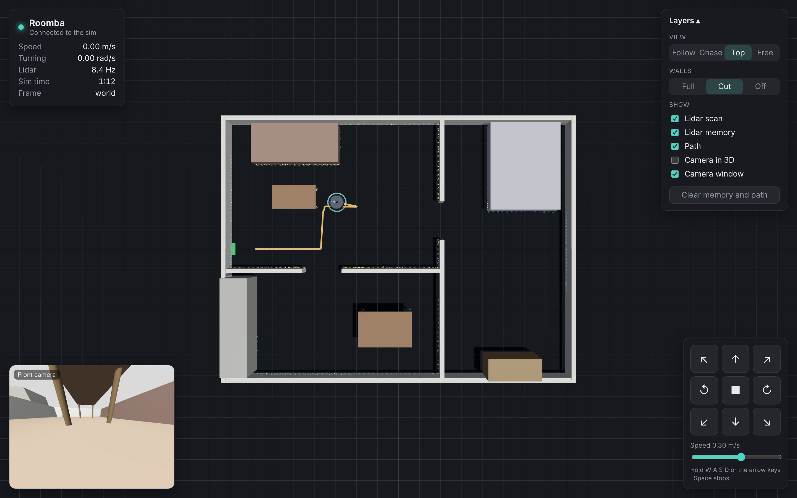

# Simulation

A simulated Roomba with the LD19 lidar and front camera, in a small apartment, running in
Gazebo Harmonic inside Docker, with our 3D web UI next to it. It publishes the **same topics as the real robot** (`/cmd_vel`,
`/odom`, `/tf`, `/scan`, `/camera/image_raw`, `/camera/camera_info`), so mapping, navigation and
the web UI can be built and tested here first and then run unchanged on the Pi.

## One-time setup (Mac)

1. Install [Docker Desktop](https://www.docker.com/products/docker-desktop/) (or OrbStack).
   In Docker Desktop settings, give it at least **4 CPUs and 6 GB of memory**.
2. Clone the repo: `git clone https://github.com/akeklak/roomba-raspi.git && cd roomba-raspi`

## Run it

```bash
./scripts/sim.sh up        # first run builds the images, about 10 minutes
```

Wait for the log to settle (about 30 seconds), then open **http://localhost:8080**.



What you see:

- **The apartment in 3D**: walls, furniture and the dock, read from the same world file Gazebo
  uses. **Walls → Cut** lowers the walls so you can see into the rooms; **Full** and **Off** too.
- **The robot**, with a teal ring around it so it's easy to find.
- **Lidar scan** (bright dots, warm when close, cool when far) and **Lidar memory** (teal dots
  that stay): every spot the lidar has hit, so the room "builds up" as you drive.
- **Path**: where the robot has been.
- **Camera**: the front camera in the corner (click it to make it bigger). **Camera in 3D** also
  draws what the camera sees as a picture in front of the robot.
- **Views**: Follow (moves with the robot, drag to orbit, scroll to zoom), Chase (rides behind
  it), Top (whole apartment from above) and Free.

Drive with **W A S D** or the **arrow keys** (hold to move, let go to stop, Space stops), or hold
the on-screen arrows. The slider sets the top speed.

**Top** shows the whole apartment:



The robot only knows where it is by counting wheel turns, and wheels slip, especially when it
pushes against furniture. On the real robot, mapping (phase 2) corrects for that. In the sim,
`ground_truth_localizer` does the correcting from Gazebo's true position for now, so the lidar
always lines up with the walls. To see the raw drift instead, start the sim with
`localization:=odom` (in `docker/compose.yaml`, add it to the end of `command`).
**Clear memory and path** starts the memory fresh.

You can also drive from the keyboard in a terminal:

```bash
./scripts/sim.sh teleop    # i = forward, , = back, j / l = turn, k = stop
```

Other commands:

```bash
./scripts/sim.sh shell     # shell inside the sim: ros2 topic list, ros2 topic hz /scan, ...
./scripts/sim.sh down      # stop
```

Code changes under `ros2_ws/src/roomba_sim` and `web/` are picked up on the next
`./scripts/sim.sh up`. For quick UI work, leave the sim running and start the UI with hot reload
instead: `cd web && npm install && npm run dev` (needs Node 22), then open http://localhost:8080
(stop the `ui` container first, or use `npm run dev -- --port 5173`).

## What's in the world

`ros2_ws/src/roomba_sim/worlds/apartment.sdf`: about 8 m × 6 m with a living room, a bedroom
and a kitchen joined by 0.9 m doorways. A coffee table and dining table whose tops sit above
the lidar, so it only sees their legs (as the real one will). A couch, bed, counter and dresser.
The dock is the green block on the west wall; the robot starts just east of it, facing east.

## How it maps to the real robot

| | Real robot | Simulation |
| --- | --- | --- |
| Drive | create_driver over serial | Gazebo DiffDrive plugin, same 0.5 m/s limit |
| Lidar | LD19, 455 beams, 10 Hz | gpu_lidar, 455 beams, 10 Hz, 1 cm noise |
| Camera | OV5647 fisheye | 640×480 wide-angle camera (~140°) |
| Frames | `odom → base_footprint → base_link → ldlidar_link`, `camera_link`, `camera_optical_link` | same, plus `world → odom` from Gazebo's true pose |
| Localization | SLAM's `map → odom` (phase 2) | `ground_truth_localizer` (perfect), or `localization:=odom` for none |

Not simulated yet: bumpers, cliff sensors, battery, docking and the vacuum. Those come with
phase 3.

## Linux server instead

The same `./scripts/sim.sh up` works on any Linux machine with Docker. On an Ubuntu 24.04 desktop
with ROS 2 Jazzy installed natively you can also see the Gazebo window:
`ros2 launch roomba_sim sim.launch.py headless:=false`.

## Automated check

CI runs `ros2 run roomba_sim smoke_test` against the sim on every pull request: it checks that
the lidar returns 455 beams that hit walls, that the camera publishes, that the world shapes for
the web UI are published on `/sim/world`, and that the robot moves about 0.9 m when driven at
0.3 m/s for 3 seconds. The web UI's own tests and build run there too.
